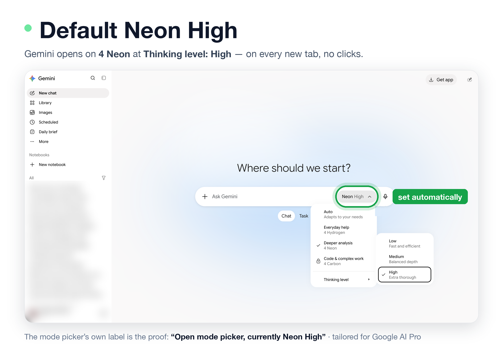

# Default Neon High — Auto-Select Gemini 4 Neon at High Thinking Level

**A free Tampermonkey userscript that makes Google Gemini open on `4 Neon` with `Thinking level: High` automatically — every new tab, no clicks.**

> **Tailored for the Google AI Pro plan.** Gemini 4 Neon is the strongest model a Pro subscriber can pick in the Gemini app; Gemini 4 Carbon is Ultra-only. Neon is not available on the free tier, so on a free account this script has nothing to select. Ultra subscribers can use it too, but may prefer Carbon.

Gemini defaults to a fast, low-effort model. If you want the strongest reasoning your Pro plan offers on every chat, you normally have to open the model picker and set two things by hand: the **Neon** mode *and* the **High** thinking level. This userscript does both for you the moment the page loads, in about a second.

> **Short answer:** install this userscript in Tampermonkey, open `gemini.google.com`, and Gemini will already be on **Neon High**. If you switch modes yourself, it backs off and leaves you alone.

---

## What it does

- **Selects Gemini 4 Neon automatically** — Google's newest reasoning model for Pro, not Hydrogen or the older Argon.
- **Sets Thinking level to High** — the deepest reasoning setting, not the Low or Medium default.
- **Runs on every new tab and every reload** — no clicking the dropdown twice.
- **Respects manual changes** — pick a different model or level yourself and it stands down for that session.
- **Verifies instead of assuming** — it reads the picker's own label and only stops when it actually says `Neon High`.
- **Never phones home** — pure local DOM code, no network requests, no tracking, no analytics.

## Install

1. Install the [Tampermonkey extension](https://www.tampermonkey.net/) for Chrome, Brave, Edge, Firefox, Safari or Opera.
2. In Chrome or Brave 138+, open `chrome://extensions`, find Tampermonkey, and enable **Allow User Scripts**. Newer Chromium builds require this toggle before any userscript can run.
3. Open the raw script: **[Default-NeonHigh.user.js](https://raw.githubusercontent.com/0xCosmosly/default-neon-high/main/Default-NeonHigh.user.js)**
4. Tampermonkey shows an install prompt — click **Install**.
5. Open [gemini.google.com](https://gemini.google.com/app). It should land on **Neon High** on its own.

### Upgrading from Default-ArgonHigh

v3.0 is a new script name and file, so Tampermonkey will not auto-update the old one. Open the Tampermonkey dashboard, delete **Default-ArgonHigh**, then install **Default-NeonHigh** with the link above. Keeping both installed makes them fight over the picker.

## Frequently asked questions

### What is Gemini 4 Neon?

Gemini 4 Neon is Google's mid-tier Gemini 4 model, released on November 18, 2026. It sits between Gemini 4 Hydrogen (fast, everyday tasks) and Gemini 4 Carbon (the flagship), and is built for coding, knowledge work and multi-step agentic tasks at lower latency than Carbon. In the Gemini app it is available to Google AI Pro and Ultra subscribers from the model drop-down.

### Why Neon and not Carbon?

This script targets the Pro plan. Carbon is only offered to AI Ultra subscribers, so on Pro, Neon at High is the strongest setting you can reach.

### What does "Neon High" mean?

Gemini separates the *model* from the *thinking level*. Models offer **Low**, **Medium** (the default) and **High**. High spends the most tokens reasoning before answering. "Neon High" means Neon selected *and* thinking level set to High.

### Why does Gemini keep resetting to a faster model?

The Gemini web app remembers a mode per conversation, and new chats often start on a lighter default. This script re-applies Neon High on each page load so you never have to think about it.

### Does this use the Gemini API or cost money?

No. It only clicks the web app's own controls. There is no API key, no network request and no billing beyond the Pro subscription you already have. It is a browser userscript, not an API client.

### Will it override my choices?

No. Once the page reaches Neon High the script stops. If you manually pick a different model or thinking level, it detects the click and stays out of your way until the next page load.

### Does it work with Greasemonkey or Violentmonkey?

Yes. It is a standard `@grant none` userscript with no Tampermonkey-specific APIs, so Greasemonkey, Violentmonkey and Tampermonkey all work.

### What happens when Google changes the UI?

The script verifies success against the picker's own `aria-label`, so a UI change cannot leave it in a half-applied state. If it cannot reach `Neon High` after several attempts, it closes the menu and stops quietly rather than looping.

### How fast is it?

About **1.3 seconds** from opening a tab to the target mode, and that includes the page load itself (measured on the Argon version).

## How it works

The script waits for Gemini's model picker, opens it, selects the `Deeper analysis — 4 Neon` row, reopens the picker, expands `Thinking level`, and chooses `High`. Each step polls for the element it needs every 40 ms instead of using fixed delays, which keeps the whole sequence under a second of visible activity.

Selectors were verified against the live Gemini UI:

| Element | Selector |
|---|---|
| Mode picker button | `button[aria-label^="Open mode picker"]` |
| Mode rows | `gem-menu-item[data-mode-id]`; category in `.label` (`Deeper analysis`), model in `.sublabel` (`4 Neon`) |
| Thinking level row | `gem-menu-item` whose text starts with `Thinking level` |
| Level rows | `gem-menu-item` starting with `Low` / `Medium` / `High` |
| Success signal | picker `aria-label`, e.g. `currently Neon High` |

The script deliberately avoids generated CSS class names (`_ngcontent-ng-c…`), which change on every Google deploy, and matches text prefixes instead of exact strings.

## Troubleshooting

| Symptom | Fix |
|---|---|
| Nothing happens | Enable **Allow User Scripts** on the Tampermonkey card in `chrome://extensions`, then reload the tab. |
| Menu opens but nothing is selected | Make sure your Google account is on **AI Pro** or Ultra. Free accounts don't have `4 Neon`. |
| It switches to Neon but not High | Check that only one copy is installed — an old **Default-ArgonHigh** will switch back to Argon. |
| It stopped working after a Gemini update | Open an issue with the current `aria-label` of the mode picker button. |

## Compatibility

| | |
|---|---|
| **Plan** | Google AI Pro (also works on Ultra) |
| **Browsers** | Any Chromium or Firefox build with Tampermonkey, Violentmonkey or Greasemonkey |
| **Matches** | `https://gemini.google.com/*` |
| **Permissions** | None — `@grant none`, no network access |
| **Version** | 3.1 |

## Changelog

- **3.1** — Match the mode row on its full text. Gemini now puts the category (`Deeper analysis`) in `.label` and the model (`4 Neon`) in `.sublabel`, so 3.0 never found Neon.
- **3.0** — Retargeted from `4 Argon` to `4 Neon` + `High` for Gemini 4 Neon (Nov 18, 2026). Renamed from `Default-ArgonHigh`; the README now says this script is tailored for the Google AI Pro plan.
- **2.2** — Poll for menu elements instead of fixed 450 ms waits; switch now completes in ~1.3 s.
- **2.1** — Fixed a stall when setting the thinking level: the `Thinking level` row is not reliably classed `expandable`, so the submenu often never opened. Also gives up cleanly after repeated failures.
- **2.0** — Retargeted from the retired Pro/Advanced mode to `4 Argon` + `High`. Renamed from `Default-GeminiPro`.

## License

MIT — see [LICENSE](./LICENSE).

---

*Previously published as `Default-ArgonHigh` (Gemini 4 Argon) and before that `Default-GeminiPro` (Gemini's older Pro/Advanced mode).*
